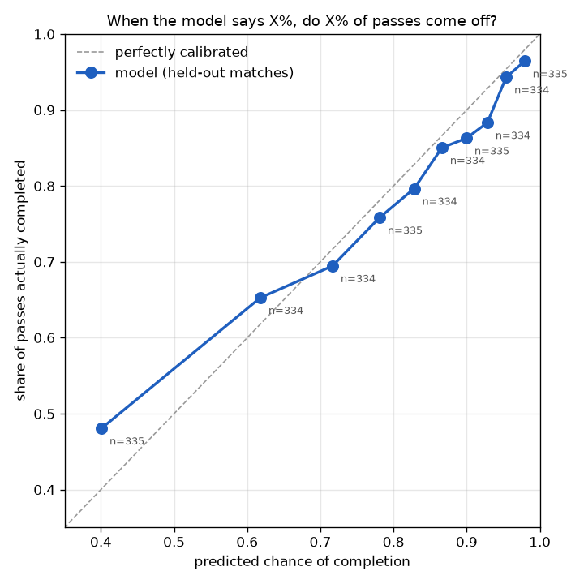
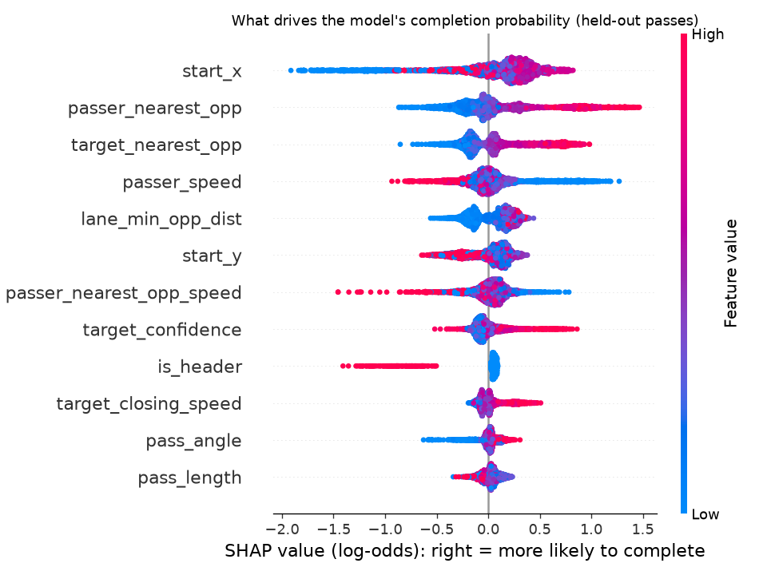
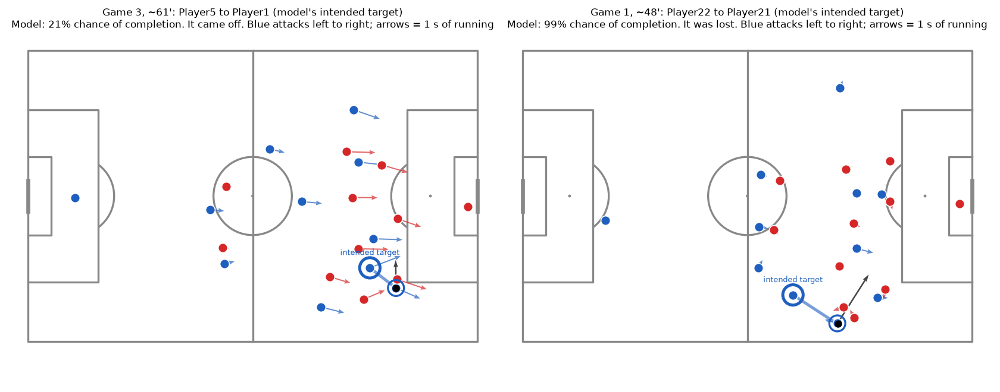

# Pass completion probability from tracking data

**Question:** at the moment a pass is played, how likely is it to reach a teammate, given where all 22 players are and how they're moving?

**Answer, in one line:** an XGBoost model using start-frame tracking features cuts held-out log loss by 8-13% compared with a pass-length baseline on every one of three unseen matches (AUC 0.73-0.75 vs 0.55-0.57). It's reasonably well calibrated. Most of its biggest mistakes come from guessing the *intended* receiver wrong, not from the completion model itself.

Every number below comes from a file in `results/`, written by `scripts/run_pipeline.py`.

## Data
[Metrica Sports sample data](https://github.com/metrica-sports/sample-data): 3 anonymised matches, 25 Hz tracking of all players and the ball, plus synchronised event data. Thanks to Metrica Sports for making it public. Games 1-2 are CSV; game 3 is EPTS FIFA tracking with JSON events. Tracking is loaded with kloppy and events with pandas or kloppy, then all three go into one schema (`src/passmodel/load.py`).

Coordinates are converted to metres (105 × 68, origin at the centre spot) and rotated so the passing team always attacks left to right in both halves (`src/passmodel/clean.py`).

Data issues found and handled (evidence in `results/` and the tests):
- The CSV events (games 1-2) use the opposite y axis to the tracking. After flipping, the event start sits a median 0.35 m from the tracked ball (it was 35 m before).
- **Game 3, second half: Player6 and Player13 (same team) have each other's IDs in the events vs the tracking**, in all 144 of their second-half events and none in the first half. The tracking IDs are swapped to match the events. We can't tell which source was wrong, so player-level attribution for these two players in that half is uncertain.
- 14 of 3,645 attempted passes (0.4%) were dropped: 1 with no tracked ball at the start frame, and 13 where the named passer was more than 5 m from the ball (`results/step1_pass_drops.csv`).

## Label: what counts as a pass (decisions D1, D2)
Metrica has no single "pass outcome" column, so the label is a rule (`clean.label_passes`, counts in `results/d1_label_counts.csv`):
- **Completed** = a `PASS` event.
- **Failed** = `BALL LOST`, plus `BALL OUT` when a player in possession put it out (but not right after a shot, clearance, tackle or another ball loss, so one loose ball isn't counted twice).
- **Excluded** from both, applied to every event type alike: theft, forced, clearance, offside, end of half, woodwork, hand ball, referee hit.

That gives 2,878 completed, 767 failed and 181 excluded events (79.0% completion). The model uses **open play only**. The 289 set-piece passes (7.9%) are kept and flagged (`results/d2_set_piece_counts.csv`).

| Match | Passes | Completion | Open-play passes | Open-play completion |
|---|---|---|---|---|
| 1 | 1,049 | 75.4% | 952 | 75.0% |
| 2 | 1,176 | 81.7% | 1,083 | 81.8% |
| 3 | 1,406 | 79.6% | 1,309 | 79.2% |
| All | 3,631 | 79.1% | 3,344 | 78.9% |

## The two leakage traps, and how they're avoided
1. **The receiver leaks the label.** Completed passes have a receiver; failed ones don't, and their recorded end point is where the ball was cut out. So no feature uses the actual receiver or the end location. Instead, an **intended target** is chosen the same way for both outcomes (D3). A logistic regression scores every teammate from start-frame information (distance, alignment with the passer's run, forward distance, how open they are, their run), and the top-scoring teammate is the target. The target model is fitted **inside each fold and never on the match it scores** (cross-fitting). It picks the actual receiver on 54-56% of completed passes in every match (`results/d3_target_agreement.csv`).
2. **Time leaks too.** Every feature uses only the pass start frame. Velocities are backward differences over 0.2 s, capped at 12 m/s. A test checks that no feature changes when future frames are altered.

Features (`src/passmodel/features.py`): pass geometry, location, pressure on the passer, space around the target and how fast the nearest defender is closing, opponents in the passing lane, player speeds, and cross/header flags. All are computed with NumPy broadcasting over passes × players, with no loops.

## Split
**Leave-one-match-out**: train on 2 matches, test on the third, 3 folds. Passes within a match are correlated, so a random split would leak. Hyperparameters are fixed defaults chosen before seeing any result (D4: depth 3, learning rate 0.05, 300 trees). As a sensitivity check, an inner CV grid is run using only the training matches.

## Results (held-out match per fold)
`results/metrics_per_fold.csv`. Lower log loss / Brier is better; higher AUC is better.

| Model | Log loss (1 / 2 / 3, mean) | ROC-AUC (1 / 2 / 3, mean) | Brier (1 / 2 / 3, mean) |
|---|---|---|---|
| Constant (training base rate) | 0.571 / 0.480 / 0.511, **0.521** | 0.50 | 0.190 / 0.151 / 0.165, **0.169** |
| Logistic, pass length only | 0.566 / 0.479 / 0.509, **0.518** | 0.572 / 0.553 / 0.554, **0.560** | 0.189 / 0.150 / 0.164, **0.168** |
| **XGBoost, all features** | 0.520 / 0.419 / 0.454, **0.464** | 0.727 / 0.748 / 0.741, **0.739** | 0.168 / 0.133 / 0.146, **0.149** |
| XGBoost, inner-CV tuned (sensitivity only) | 0.511 / 0.422 / 0.446, **0.459** | 0.727 / 0.744 / 0.756, **0.742** | 0.168 / 0.132 / 0.144, **0.148** |

- **XGBoost beats the baseline on every match.** Log loss vs the logistic baseline, with 95% paired bootstrap CIs (`results/step5_bootstrap_ci.csv`): −0.046 [−0.076, −0.018], −0.060 [−0.083, −0.038], −0.055 [−0.078, −0.034]. These CIs resample passes within a match, so they show sampling noise, not match-to-match variation. The per-fold spread shows the latter.
- **Pass length alone is nearly useless**: it barely beats the constant model (the CI includes zero on every match).
- **Tuning doesn't matter much.** Inner CV chose depth 2, learning rate 0.03, 200 trees in every fold (`results/d4_inner_cv.csv`), and is within 0.01 log loss of the defaults on each match. The headline stays the pre-registered defaults.

### Calibration


Pooled held-out passes in 10 equal-count bins (`results/step5_calibration.csv`). **When the model says about 72%, 69% of passes come off.** At the extremes it's a little too confident: about 93% predicted → 88% observed, and about 40% predicted → 48% observed.

### What drives it (SHAP)


Mean |SHAP| on held-out passes (`results/step5_shap_importance.csv`). The top three, in football terms:
1. **Space around the intended target** (`target_nearest_opp`): the more room the receiver has, the more likely the pass arrives.
2. **Where the pass starts** (`start_x`): passes from deep in your own half are the riskiest; passes from midfield are the safest.
3. **Pressure on the passer** (`passer_nearest_opp`): with an opponent close by, passes go astray more often.

### Does each feature group earn its place? (ablation)
XGBoost refitted without each group. Δ = increase in held-out log loss, so positive means the group helps (`results/step5_ablation.csv`, CIs in `results/step5_ablation_ci.csv`).

| Without | Δ match 1 | Δ match 2 | Δ match 3 | Mean | Helps on |
|---|---|---|---|---|---|
| location | 0.017 | 0.026 | 0.012 | 0.019 | 3/3 |
| pressure | 0.001 | 0.012 | 0.010 | 0.008 | 3/3 |
| event flags | 0.006 | 0.007 | 0.008 | 0.007 | 3/3 |
| target | −0.004 | 0.007 | 0.012 | 0.005 | 2/3 |
| geometry | 0.005 | 0.010 | 0.001 | 0.005 | 3/3 |
| speed | −0.001 | 0.006 | 0.008 | 0.004 | 2/3 |
| lane | −0.003 | 0.007 | 0.004 | 0.003 | 2/3 |

Location and pressure clearly earn their place. **Speed and lane congestion don't help on match 1, and most of their CIs include zero.** That's a negative result, reported as such. The headline model keeps every group, because dropping groups based on these test-match scores would be tuning on the test set.

## A pass, shown as football


Blue = passing team (attacking left to right), red = defenders, arrows = where each player will be in 1 s, thick ring and solid line = the model's intended target, dashed arrow = where the ball actually went (from events; context only, never a model input).
- **Left:** the riskiest completed pass in the opponents' half where the intended target was the real receiver. The model gave it **21%** and it came off: several defenders are close to the passer and one is on the line of the pass.
- **Right:** the failure the model was most sure about (**99%**). The ball went forward into the box, but the target model picked a short, free option. The model scored a pass that wasn't played.

### 10 riskiest completed passes (`results/step6_riskiest_completed.csv`)
| Match | ~Min | Passer | Intended target | Actual receiver | P(complete) |
|---|---|---|---|---|---|
| 1 | 36 | Player7 | Player9 | Player8 | 8% |
| 3 | 88 | Player14 | Player5 | Player6 | 12% |
| 3 | 18 | Player11 | Player6 | Player3 | 13% |
| 2 | 74 | Player18 | Player26 | Player24 | 14% |
| 3 | 95 | Player17 | Player11 | Player10 | 14% |
| 3 | 59 | Player24 | Player28 | Player26 | 17% |
| 3 | 53 | Player21 | Player26 | Player24 | 18% |
| 3 | 8 | Player28 | Player19 | Player23 | 19% |
| 1 | 23 | Player3 | Player11 | Player11 | 21% |
| 3 | 61 | Player5 | Player1 | Player1 | 21% |

Minutes are minutes of play from kick-off (frame / 1,500), not the match clock. **The intended target was the real receiver on only 2 of these 10**, against 54-56% overall: most of the "riskiest completed passes" are really passes to a different teammate from the one the target model guessed. The 10 safest failures (`results/step6_safest_failed.csv`, predicted 97.5-98.7%) all have an intended target with 8-20 m of space and nobody in the lane, which again points to target errors.

### Completion above expected, with a strong caveat
`results/step6_completion_above_expected.csv` gives each player's completion rate minus the model's expectation (players with at least 40 passes in a match). The mean per match is −4.7 pts (match 1), +4.8 (match 2) and −0.1 (match 3). That's a **match effect**, not player skill: match 2's base rate is higher and the model never saw it while training. With 40-90 passes per player, most differences are within 2 standard errors of zero. Not a player ranking.

## Scaling
Tracking is the biggest data in football: here, **9,727,275 position rows** for 3 matches (about 3.2M per match). The pipeline is built as if it had to run on a full season:
- tracking is stored as long-format Parquet, one file per match, processed one match at a time, so memory doesn't grow with the number of matches;
- velocities are computed for every frame at once with grouped NumPy differences;
- features read **only the pass start frames** from Parquet: 167,347 rows, 1.7% of the table;
- every stage logs wall time and peak memory to `results/benchmarks.csv`.

Measured on a Windows laptop during a fresh-clone `--rebuild` run (6 Nov 2026), then projected to 380 matches (`results/step7_scaling.csv`; projection = measured × 380 / 3):

| Stage | Rows out (3 matches) | Wall time (3 matches) | Peak traced memory | Projected season |
|---|---|---|---|---|
| Load raw tracking → long format (kloppy) | 9,727,275 | 363.6 s | 2,315 MB | 768 min |
| Clean (ID fixes, metres, flip, velocities) | 9,727,275 | 1.0 s | 364 MB | 2.0 min |
| Write Parquet | | 2.8 s | 148 MB | 5.9 min |
| Read tracking at pass frames only | 167,347 | 0.2 s | 4.5 MB | 0.5 min |
| Build pass table | 3,645 | 0.4 s | 4.2 MB | 0.8 min |
| Build features (all folds) | 10,893 | 0.6 s | 21 MB | 1.2 min |
| **All stages** | | **368.5 s** | **2,315 MB** | **778 min** |

- **A full season is an estimated ~13 hours on one laptop core, and 99% of that is parsing the raw provider files** (768 of 778 min). Everything after the data is in Parquet, from cleaning to features, projects to about 10 minutes per season. Matches are independent, so loading parallelises across cores or machines, and in a club it happens once per match as data arrives.
- **Memory stays at the single-match peak.** Peak traced memory is 2.3 GB, and the operating system's process peak is 7.0 GB, reached while kloppy parses game 3's EPTS file. The traced figure comes from `tracemalloc`, which can't see memory allocated inside Arrow's C++ pool, so Parquet stages are lower bounds. The process figure covers everything.
- **Storage:** about 57 MB of Parquet per match (`results/tracking_files.csv`), so about 21.6 GB per season.
- This is an estimate: it assumes season matches look like these three.

## Limitations
- **Three matches is a tiny sample.** Three test folds of 952-1,309 passes. The per-fold spread is a better guide to uncertainty than any single number, and results could change with more matches.
- **The intended target is an approximation.** It matches the real receiver on about 55% of completed passes, and the model's biggest mistakes are mostly target errors. A better target (for example, choosing from the ball's initial direction in the first few frames, if that can be done without leaking) is the most promising next step.
- **Anonymised teams and players**, and player IDs may not refer to the same person across matches. Player-level results are not meaningful here.
- **Event-tracking sync error:** event frames are hand-tagged, so the start frame can be a few frames off. 13 passes were dropped where the passer was more than 5 m from the ball.
- **Match context is missing:** score, game state and team strength aren't features, which shows up as match-level miscalibration (match 2 completes more than predicted).
- **No pitch control** (the stretch goal in `PLAN.md` wasn't attempted).

## How to reproduce
```powershell
uv sync
uv run python scripts/download_data.py
uv run python scripts/run_pipeline.py --rebuild
uv run pytest
```
Tested from a fresh clone (new environment, fresh download, `--rebuild`): every results table reproduced byte for byte.

`--rebuild` rebuilds the tracking Parquet and rewrites `results/benchmarks.csv`. Without it, existing Parquet files are reused and timings go to `results/logs/`. Notebooks `notebooks/00`-`05` show each step's results.
